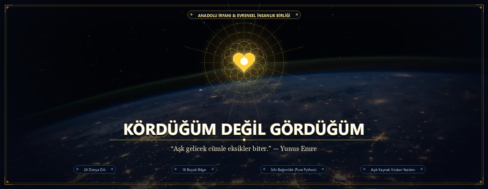
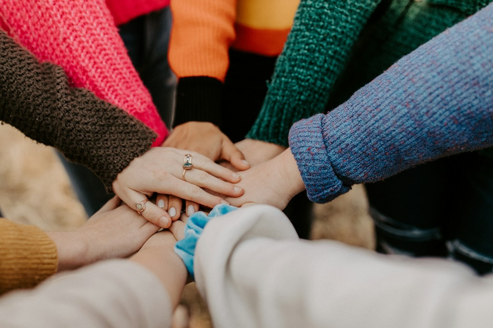
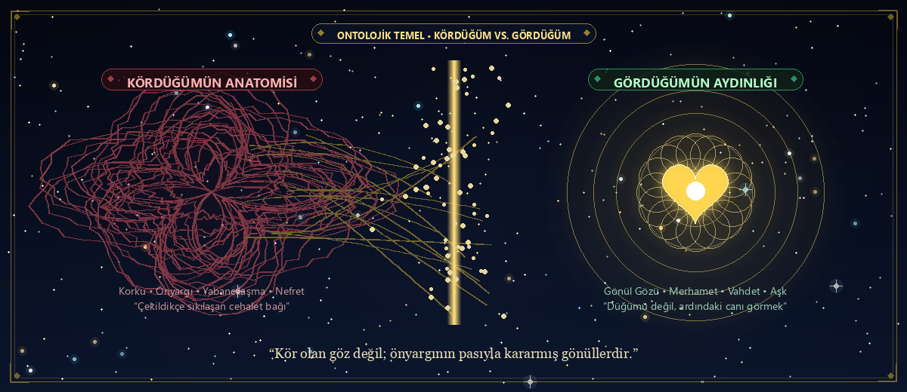
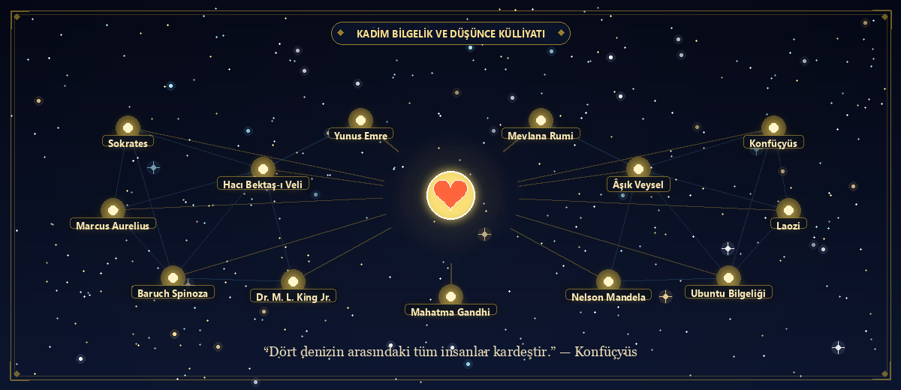
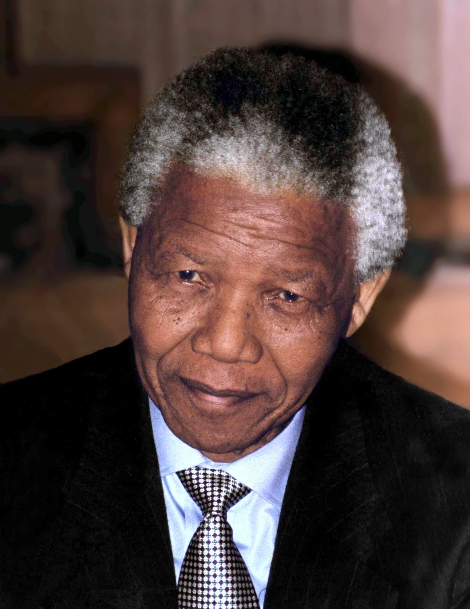
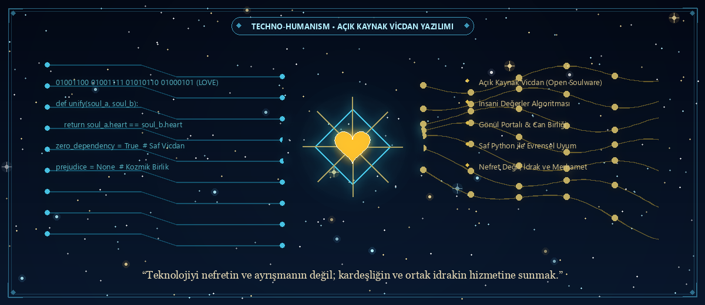
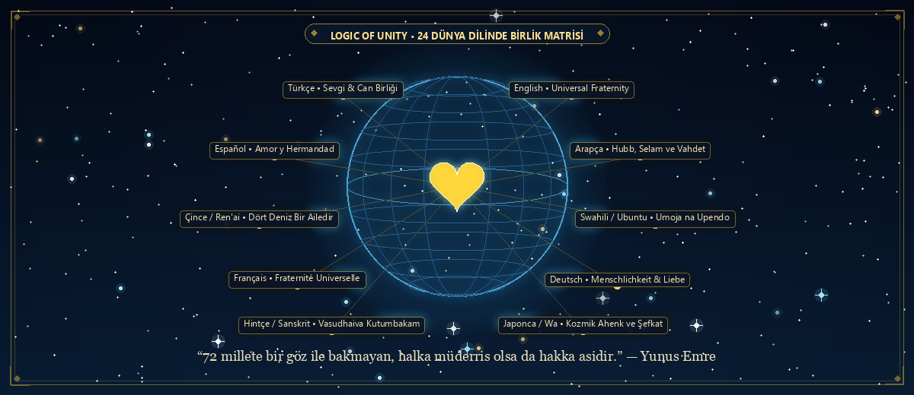
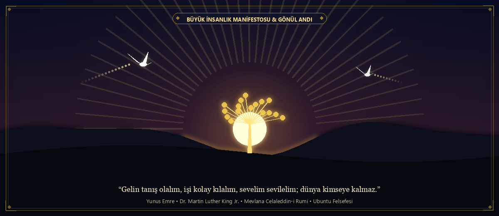

<p align="center">
  
</p>

# 🪢 Kördüğüm-Değil-Gördüğüm

> **"Aşk gelicek cümle eksikler biter."** — *Yunus Emre*  
> **"Karanlık karanlığı kovamaz; bunu sadece ışık yapabilir. Nefret nefreti kovamaz; bunu sadece sevgi yapabilir."** — *Dr. Martin Luther King Jr.*  
> **"Gözün gördüğüne gönül katılmazsa, bakış sadece bir kördüğümdür."** — *Mevlana Celaleddin-i Rumi*  
> **"Dört denizin arasındaki tüm insanlar kardeştir."** — *Konfüçyüs*  
> **"Ubuntu: Ben, biz olduğumuz için benim."** — *Afrika Kadim Bilgeliği*

---

[](https://github.com/arch-yunus/Kordugum-Degil-Gordugum/actions/workflows/ci.yml)


-brightgreen.svg)


---

## 📌 İçindekiler Tablosu

1. [Projenin Ruhu ve Doğuş Sebebi](#-projenin-ruhu-ve-doğuş-sebebi)
2. [Ontolojik Temel: Neden "Kördüğüm Değil Gördüğüm"?](#-ontolojik-temel-neden-kördüğüm-değil-gördüğüm)
   * [Kördüğümün Anatomisi (Korku ve Cehalet)](#kördüğümün-anatomisi)
   * [Gördüğümün Aydınlığı (Gönül Gözü ve Can)](#gördüğümün-aydınlığı)
3. [Kadim Bilgelik ve Düşünce Külliyatı (Genişletilmiş Alıntılar Galerisi)](#-kadim-bilgelik-ve-düşünce-külliyatı)
   * [1. Anadolu ve Doğu İrfanı: Gönül Medeniyeti](#1-anadolu-ve-doğu-irfanı-gönül-medeniyeti)
   * [2. Antik Dünya ve Felsefe Tarihi](#2-antik-dünya-ve-felsefe-tarihi)
   * [3. Doğu, Asya ve Afrika Bilgeliği](#3-doğu-asya-ve-afrika-bilgeliği)
   * [4. Evrensel İnsan Hakları ve Sivil Özgürlük Öncüleri](#4-evrensel-insan-hakları-ve-sivil-özgürlük-öncüleri)
   * [5. Dünya Edebiyatı ve Şiirin Vicdanı](#5-dünya-edebiyatı-ve-şiirin-vicdanı)
4. [Teknoloji, Yapay Zekâ ve Vicdan (Techno-Humanism)](#-teknoloji-yapay-zekâ-ve-vicdan-techno-humanism)
   * [Sıfır-Bağımlılık (Zero-Dependency) Felsefesi](#sıfır-bağımlılık-felsefesi)
   * [Açık Kaynak Vicdan Yazılımı (Open Soulware)](#açık-kaynak-vicdan-yazılımı)
5. [🌐 Canlı Web Portalı (Gönül Portalı)](#-canlı-web-portalı-gönül-portalı)
6. [🛠 Repository Katmanları ve Teknik Mimari](#-repository-katmanları-ve-teknik-mimari)
   * [1. Logic-of-Unity (Birliğin Mantığı - Algoritmalar)](#1-logic-of-unity-birliğin-mantığı)
   * [2. The-Universal-Library (Evrensel Kütüphane)](#2-the-universal-library-evrensel-kütüphane)
   * [3. Wisdom-Archive (16 Büyük Bilge Düşünür)](#3-wisdom-archive-16-büyük-bilge-düşünür)
   * [4. languages (24 Dünya Dilinde Sevgi Matrisi)](#4-languages-24-dünya-dilinde-sevgi-matrisi)
   * [5. stories (Gerçek Yaşamdan İyileşme Hikâyeleri)](#5-stories-gerçek-yaşamdan-iyileşme-hikâyeleri)
7. [💻 CLI & Terminal Kullanım Kılavuzu](#-cli--terminal-kullanım-kılavuzu)
8. [🧪 Birim Testleri ve Doğrulama](#-birim-testleri-ve-doğrulama)
9. [🤝 Katkıda Bulunma Rehberi (Gönül Birliği Çağrısı)](#-katkıda-bulunma-rehberi)
10. [📜 Büyük İnsanlık Manifestosu & Kapanış Andı](#-büyük-insanlık-manifestosu--kapanış-andı)

---

## 🕊️ Projenin Ruhu ve Doğuş Sebebi

Bu repository; insanlığın binlerce yıldır korku, cehalet, kibir ve hırsla kendi elleriyle attığı o en sert düğümü —**ırkçılık, etnik milliyetçilik, ayrımcılık, yabancı düşmanlığı (zenofobi) ve ötekileştirmeyi**— tartışıp çekiştirerek daha da sıkılaştırmak için değil; o düğümün aslında **hiç var olmaması gerektiğini** hatırlatmak için kuruldu.

Bizim için dünya, dikenli tellerle, pasaport renkleriyle ve siyasi sınırlarla parsellenmiş soğuk bir mülk değildir. Bizim için dünya; canların, nefeslerin ve ruhların ezelden ebede birleştiği devasa bir **Aşk Meydanı**dır.

Her insan dünyaya tertemiz bir vicdanla ve sevme kabiliyetiyle doğar. Ten rengi, göz kapağının kıvrımı, anadilin melodisi ya da doğulan coğrafya; bir insanın diğerine üstünlük kurma aracı değil; kâinat orkestrasının en zengin, en ahenkli enstrümanlarıdır.

<p align="center">
  
  <br/>
  <em>"Farklılıklarımız bir tehdit değil; insanlık orkestrasının en ahenkli sesleridir."</em>
</p>

---

## 🧐 Ontolojik Temel: Neden "Kördüğüm Değil Gördüğüm"?

<p align="center">
  
</p>

### Kördüğümün Anatomisi
İnsan zihni, tanımadığı ve anlamadığı şeyden korkar. Korku şüpheyi, şüphe mesafeyi, mesafe ise düşmanlığı doğurur. Birey kendi içindeki yetersizlikleri, eksiklikleri ve acıları ötekinin kimliğine yansıttığında ortaya çıkan o zehirli yapıya **"ırkçılık"** diyoruz.

Bu yapı tam anlamıyla bir **kördüğümdür**:
* **Öfkeyle çektikçe sıkılaşır:** Nefrete nefretle cevap verildiğinde iki taraf da düğümün esiri olur.
* **Akılla çözülmeye çalışıldıkça körleşir:** Salt teorik ve mekanik tartışmalar, kalbin hissetmediği hiçbir yarayı iyileştiremez.
* **Siyasetle beslendikçe kangrene döner:** Güç odakları, insanları bölerek yönetmeyi seçtiğinde düğüm nesilden nesile bir miras gibi devredilir.

### Gördüğümün Aydınlığı
Biz bu kördüğümü çözmek için o düğümle boğuşmuyoruz. Çekildikçe sıkışan ipe değil, ipin ardındaki **insana**, **ruha** ve **öze** bakıyoruz. Biz düğümü değil, **canı görüyoruz**:

| Kavram | Temsil Ettiği Durum | Zihinsel & Ruhsal Karşılığı |
|---|---|---|
| **Kördüğüm** | Dışarıdan dayatılan önyargı | Korku, cehalet, tarihsel şartlanma, ayrışma, üstünlük taslama |
| **Gördüğüm** | Kalbin aracısız idraki | Öz, ışık, merhamet, "sen bensin" cesareti, sınırsız kucaklaşma |

> *"Kör olan göz değil; önyargının pasıyla kararmış, ötekini düşman belleyen gönüllerdir.*  
> *Gönül bir kez uyandı mı, kördüğüm sandığımız her şey bir anda çözülür ve sadece Aşk kalır."*

---

## 📜 Kadim Bilgelik ve Düşünce Külliyatı

<p align="center">
  
</p>

Bu projenin her kod satırı, yüzyıllardır dünyanın dört bir yanında aynı hakikati fısıldayan bilgelerin, mutasavvıfların, şairlerin ve adalet savaşçılarının ortak vicdan nefesiyle yazılmıştır.

### 1. Anadolu ve Doğu İrfanı: Gönül Medeniyeti

Anadolu mayası; farklılıkları bir tehdit olarak değil, Yaratılışın sonsuz birliği (Tevhid) olarak gören eşsiz bir irfan havzasıdır.

> *"Düşmanımız kindir bizim, kamu alem birdir bize.*  
> *Yunus der ki gör takdirin işleri, dökülmüştür kirpikleri kaşları,*  
> *Başları ucunda hece taşları, ne söylerler ne bir haber verirler.*  
> *Gelin tanış olalım, işi kolay kılalım, sevelim sevilelim; dünya kimseye kalmaz.*  
> *Ben gelmedim dava için, benim işim sevi için;*  
> *Dostun evi gönüllerdir, gönüller yapmaya geldim."*  
> — **Yunus Emre (1238 – 1320, Anadolu)**

> *"Yetmiş iki milleti bir gör.*  
> *Hararet nardadır, sacda değildir; keramet baştadır, tacda değildir.*  
> *Her ne arar isen kendinde ara; Kudüs'te, Mekke'de, Hac'da değildir.*  
> *Dili, dini, rengi ne olursa olsun; iyiler iyidir.*  
> *Bir olalım, iri olalım, diri olalım. İncinsen de incitme."*  
> — **Hacı Bektaş-i Veli (1209 – 1271, Horasan & Kapadokya)**

> *"Gel, gel, ne olursan ol yine gel!*  
> *İster kâfir, ister mecusi, ister puta tapan ol yine gel.*  
> *Bizim dergâhımız ümitsizlik dergâhı değildir.*  
> *Yüz kere tövbeni bozmuş olsan da yine gel.*  
> *Sevgiyle acılar tatlılaşır, sevgiyle bakırlar altın olur,*  
> *Sevgiyle tortular durulur, sevgiyle ölüler dirilir,*  
> *Sevgiyle padişahlar kul olur köle olur."*  
> — **Mevlana Celaleddin-i Rumi (1207 – 1273, Belh & Konya)**

> *"Beni hor görme gardaşım,*  
> *Sen altınsın ben tunç muyum?*  
> *Aynı vardan var olmuşuz,*  
> *Sen gümüşsün ben saç mıyım?*  
> *Kürt'ü Türk'ü ne Çerkez'i, hep Adem'in oğlu kızı,*  
> *Beraberce şehit gazi, yanlış yola gitmeyelim.*  
> *Kimi nefsine kul olmuş, kimi hırsına boğulmuş,*  
> *Cümle canlar hep bir olmuş, ayrılık gütmeyelim."*  
> — **Âşık Veysel Şatıroğlu (1894 – 1973, Sivas)**

> *"Âdemoğulları bir vücudun uzuvları gibidir; çünkü aynı cevherden yaratılmışlardır.*  
> *Felek bir uzva dert ve elem verirse, diğer uzuvlarda da huzur ve karar kalmaz.*  
> *Ey başkalarının acısıyla hüzünlenmeyen, yarasıyla sızlamayan kişi!*  
> *Sana insan adını vermek yakışmaz."*  
> — **Sadi Şirazi (Gülistan, 1258, İran)**

> *"Gelin canlar bir olalım, münkirin bağrın delelim.*  
> *Bir bahçeye giremezsen durup seyran eyleme.*  
> *Bir gerçek gül koklamazsan her dikeni koklama.*  
> *Demiri demirle dövdüler; biri sıcak biri soğuktu.*  
> *İnsanı insanla kırdılar; biri açtı biri toktu."*  
> — **Pir Sultan Abdal (16. Yüzyıl Sivas)**

> *"Gönülden gönüle gider bir yol vardır gizli gizli.*  
> *Kalpten kalbe bir kapı vardır; açan bilir, gören bilir.*  
> *İncitme canı incitme, can inciten iflah olmaz.*  
> *Dostun gül cemaline bak, yabana bakma."*  
> — **Neşet Ertaş (Bozkırın Tezenesi)**

---

### 2. Antik Dünya ve Felsefe Tarihi

İnsan aklının ulaştığı en berrak anlar, sınırların yapaylığını ve kozmik kardeşliği idrak ettiği anlardır.

> *"Ben ne bir Atinalıyım ne de bir Yunan; ben bir dünya vatandaşıyım (Kosmopolites)."*  
> — **Sokrates (MÖ 469 – 399, Antik Yunan)**

> *"Bizler birbirimizle işbirliği yapmak için doğduk; tıpkı ayaklar gibi, eller gibi, alt ve üst çenenin dişleri gibi.*  
> *Birbirimize karşı öfkelenmek ve sırt dönmek doğaya aykırıdır.*  
> *Tek bir bedenin organları nasıl birbirini incitmezse, insanlar da birbirine zarar veremez."*  
> — **Marcus Aurelius (Kendime Düşünceler, MS 121 – 180, Roma)**

> *"İnsanlığı hem kendi şahsında hem de bir başkasının şahsında asla sadece bir araç olarak değil, her zaman ve aynı zamanda bir amaç olarak görecek şekilde davran."*  
> — **Immanuel Kant (Ahlak Metafiziğinin Temellendirilmesi, 1785)**

> *"Nefret, sevginin yokluğundan doğan bir eksikliktir; tıpkı soğuğun ısının yokluğu olması gibi.*  
> *Nefreti ancak daha büyük ve kapsayıcı bir sevgi alt edebilir."*  
> — **Baruch Spinoza (Etika, 1677)**

> *"Dikkat, cömertliğin en nadir ve en saf biçimidir.*  
> *Talihsizliğin pençesinde kıvranan bir insana verilebilecek en büyük armağan, ona 'Neyin var, ne acı çekiyorsun?' sorusunu bütün varlığınla sorabilmektir.*  
> *Irkçı önyargı, bu dikkatin ve bakışın tam zıttıdır; karşısındakini yok saymaktır."*  
> — **Simone Weil (Yerçekimi ve İnayet, Fransa)**

---

### 3. Doğu, Asya ve Afrika Bilgeliği

Doğu ve Afrika bilgeliği, insanı evrenden ayrı bir fert olarak değil; kainatın ayrılmaz bir dokusu olarak görür.

> *"Dört denizin arasındaki tüm insanlar kardeştir.*  
> *Kendine yapılmasını istemediğin bir şeyi başkasına yapma.*  
> *Asil insan erdemiyle birleştirir; küçük insan menfaatiyle ayrıştırır."*  
> — **Konfüçyüs (Konuşmalar / Lunyu, Çin)**

> *"Bütün varlıkları kendi özün gibi sev.*  
> *Kötülüğe iyilikle karşılık ver. En yumuşak su, en sert kayayı aşındırır.*  
> *Kendini başkalarının üstünde gören, kendi ışığını söndürür."*  
> — **Laozi (Dao De Jing, Çin)**

> *"Nasıl bir anne tek çocuğunu kendi canı pahasına korursa,*  
> *sen de tüm canlılara karşı sınırsız, koşulsuz ve ayrımsız bir şefkat geliştir.*  
> *Nefret nefretle dinmez; nefret sadece sevgiyle son bulur. Bu ebedi bir yasadır."*  
> — **Gautama Buda (Metta Sutta)**

> *"Ubuntu: 'Umuntu ngumuntu ngabantu.'*  
> *Bir insan, ancak başka insanlar sayesinde insandır.*  
> *Benim sevincim senin sevincinle çoğalır, benim yaram senin acınla sızlar.*  
> *Bir başkasının onurunu çiğneyen, ilk önce kendi insanlığını ayaklar altına alır."*  
> — **Kadim Afrika Ubuntu Felsefesi (Güney Afrika / Xhosa & Zulu)**

---

### 4. Evrensel İnsan Hakları ve Sivil Özgürlük Öncüleri

Zulmün, ayrımcılığın ve köleliğin en koyu karanlığında sesini yükseltenler, insanlığın ortak hafızasını aydınlatmıştır.

<p align="center">
  
  <br/>
  <em>Dr. Martin Luther King Jr. — 1963 Tarihi Washington Yürüyüşü ("I Have a Dream")</em>
</p>

> *"Bir hayalim var: Gün gelecek, dört küçük çocuğum, derilerinin rengine göre değil, karakterlerinin içeriğine göre değerlendirildikleri bir ülkede yaşayacaklar.*  
> *Bir hayalim var: Georgia'nın kızıl tepelerinde, eski kölelerin çocukları ile eski köle sahiplerinin çocukları aynı kardeşlik masasında birlikte oturabilecekler.*  
> *Karanlık karanlığı kovamaz; bunu sadece ışık yapabilir. Nefret nefreti kovamaz; bunu sadece sevgi yapabilir.*  
> *Herhangi bir yerdeki adaletsizlik, her yerdeki adalet için doğrudan bir tehdittir."*  
> — **Dr. Martin Luther King Jr. (1963, Washington)**

<p align="center">
  
  <br/>
  <em>Nelson Mandela — "Ubuntu: Ben, biz olduğumuz için benim." (1994)</em>
</p>

> *"Hiç kimse derisinin rengi, geçmişi ya da inandığı din yüzünden bir diğerinden nefret ederek doğmaz.*  
> *İnsanlar nefret etmeyi sonradan öğrenirler.*  
> *Ve eğer nefret etmeyi öğrenebiliyorlarsa, onlara sevmeyi de pekala öğretebiliriz;*  
> *çünkü sevgi, insan kalbine ve fıtratına nefretten çok daha doğal gelir."*  
> — **Nelson Mandela (Özgürlüğe Giden Uzun Yol)**

> *"Mekke'de dünyanın dört bir yanından gelmiş insanlarla yan yana namaz kıldım.*  
> *Mavi gözlü sarışınlardan simsiyah tenli Afrikalılara kadar herkes aynı saftaydı.*  
> *Orada gördüm ki hakiki kardeşlik; dillerin, tenlerin ve ırkların ötesinde, kalplerin ve ruhların birliğidir.*  
> *Irkçılık, insanın kendi yetersizliğini başkasını ezerek telafi etme çabasıdır."*  
> — **Malcolm X (El-Hac Mâlik eş-Şahbâz)**

> *"Göze göz ilkesi, sonunda bütün dünyayı kör eder.*  
> *Dünyada görmek istediğin değişimin bizzat kendisi ol.*  
> *Şiddetsizlik (Ahimsa), korkakların silahı değil; cesurların en yüce erdemidir.*  
> *Hakikatin gücü (Satyagraha) karşısında hiçbir ordu, hiçbir imparatorluk ebediyen duramaz."*  
> — **Mahatma Gandhi (Hindistan)**

> *"Yorgun olduğum tek bir şey vardı: Boyun eğmekten yorulmuştum.*  
> *İnsanlar ayağa kalkmadıkça sırtlarına binen zalimler asla inmez.*  
> *Ben o gün otobüsteki koltuğumdan kalkmamayı seçtiğimde, aslında bütün bir halkın haysiyeti için ayaktaydım."*  
> — **Rosa Parks (1955, Montgomery)**

> *"Ey insanlar! Rabbiniz birdir, babanız birdir. Hepiniz Âdem'densiniz, Âdem de topraktandır.*  
> *Arap'ın Arap olmayana, Arap olmayanın Arap'a; beyazın siyaha, siyahın beyaza takva ve adalet dışında hiçbir üstünlüğü yoktur.*  
> *İnsanlar bir tarağın dişleri gibi eşittir."*  
> — **Hz. Muhammed (Veda Hutbesi, MS 632, Arafat)**

> *"Birçok kişinin önünde ifade edildiğinde pek hoş karşılanmayacak olsa da, ırkçılık beyaz adamın hastalığıdır.*  
> *Bu sessiz kalabileceğimiz bir konu değil. Vicdanım sustukça ruhum huzur bulmuyor.*  
> *Ayrımcılık yalnızca mağdurları ezmekle kalmaz; ayrımcılık yapanların kendi ruhunu da çürütür."*  
> — **Albert Einstein (1946, Lincoln Üniversitesi)**

> *"Hakikatin rengi yoktur, adaletin cinsiyeti yoktur.*  
> *Bütün uluslar tek bir kandan yapılmıştır.*  
> *Özgürlük herkes için güvence altına alınmadıkça, hiç kimse için gerçek ve kalıcı olamaz."*  
> — **Frederick Douglass (1852, ABD)**

> *"İdeal toplumum; özgürlük, eşitlik ve kardeşliğe dayanan toplumdur.*  
> *Kardeşlik nedir? Kardeşlik, kişinin diğer insanlara karşı sergilediği saygı, sıcaklık ve derin yakınlık tavrıdır.*  
> *Kardeşliğin olmadığı bir yerde demokrasi sadece içi boş bir tabeladır."*  
> — **Dr. B. R. Ambedkar (Kast Sisteminin Yok Edilmesi, 1936, Hindistan)**

---

### 5. Dünya Edebiyatı ve Şiirin Vicdanı

Şiir, kalbin evrensel pasaportudur; sınır tanımaz, tercümeye hapsolmaz.

> *"Yaşamak bir ağaç gibi tek ve hür*  
> *ve bir orman gibi kardeşçesine,*  
> *bu hasret bizim...*  
> *Bilekler kan içinde, dişler kenetli, ayaklar çıplak*  
> *ve ipek bir halıya benzeyen toprak,*  
> *bu cehennem, bu cennet bizim.*  
> *Kapansın el kapıları, bir daha açılmasın,*  
> *yok edin insanın insana kulluğunu,*  
> *bu davet bizim..."*  
> — **Nâzım Hikmet Ran (Davet)**

> *"Yeryüzü benim memleketimdir ve insanlık benim ailemdir.*  
> *Sen benim kardeşimsin ve ben seni seviyorum.*  
> *İster caminde secde et, ister kilisende diz çök, ister havranda dua et...*  
> *Sen ve ben, hepimiz tek bir ilahi Ruh'un evlatlarıyız.*  
> *Birbirimize düşman olmamız için hiçbir hakiki sebep yoktur."*  
> — **Halil Cibran (Lübnan & Dünya)**

> *"Aklın korkusuz olduğu ve başın dik durduğu yer;*  
> *Bilginin özgür olduğu;*  
> *Dünyanın dar ev duvarlarıyla küçük parçalara bölünmediği yer;*  
> *Sözlerin hakikatin derinliğinden çıktığı yer;*  
> *Berrak aklın akıntısının geleneklerin çöl kumlarında kaybolmadığı yer...*  
> *Ey Tanrım, insanlığı o özgürlük sabahına uyandır."*  
> — **Rabindranath Tagore (Gitanjali - Song Offerings, Hindistan)**

> *"In minor ways we differ,*  
> *in major we're the same.*  
> *I note the obvious differences*  
> *between each sort and type,*  
> *but we are more alike, my friends,*  
> *than we are unalike.*  
> *Küçük şeylerde farklıyız, büyük şeylerde aynıyız dostlarım;*  
> *Birbirimize benzeyişimiz, benzemeyişimizden katbekat büyüktür."*  
> — **Maya Angelou (Human Family, ABD)**

> *"Ben sevgiden başka hiçbir gücün bizi kurtarabileceğine inanmıyorum.*  
> *Ama sevgi derken tatlı bir nezaket perdesinden bahsetmiyorum;*  
> *korkularımızın ardındaki maskeleri söküp atan, cesur ve dönüştürücü bir sevgiden bahsediyorum.*  
> *Yüzleşilen her şey değiştirilemez; ama hiçbir şey yüzleşilmeden değiştirilemez.*  
> *İnsanlar sırf kendi acılarıyla yüzleşmemek için başkalarına zulmederler."*  
> — **James Baldwin (Ateşin Bir Dahaki Sefer / The Fire Next Time)**

> *"Hiçbir ırk güzelliğin, aklın ya da gücün tekelini elinde tutmaz.*  
> *Fethi tamamlanacak olan buluşma yerinde, herkese yer vardır.*  
> *Biz buradayız, ayaktayız ve insanız."*  
> — **Aimé Césaire (Geri Dönüş Defteri / Cahier d'un retour au pays natal, Martinique)**

> *"No quiero la patria dividida en siete puñales de sangre...*  
> *Pido paz para el obrero que camina,*  
> *Pido paz para el trigo que nace,*  
> *Pido paz para todos.*  
> *Yedi kanlı hançerle bölünmüş bir vatan istemiyorum;*  
> *Yürüyen işçi için barış istiyorum, filizlenen buğday için barış istiyorum,*  
> *Bütün dünya insanları için barış istiyorum."*  
> — **Pablo Neruda (Canto General, Şili)**

> *"Düşün başkalarını...*  
> *Sabah kahvaltını hazırlarken başkalarını düşün (güvercinlerin yemini unutma).*  
> *Savaşlarına giderken başkalarını düşün (barış isteyenleri unutma).*  
> *Su faturanı öderken başkalarını düşün (bulutları emenleri unutma).*  
> *Evine dönerken başkalarını düşün (çadır halkını unutma).*  
> *Uyurken ve yıldızları sayarken başkalarını düşün (uyuyacak yer bulamayanları unutma).*  
> *Kendi kendine düşünürken de başkalarını düşün (bir mum gibi eriyenleri unutma)."*  
> — **Mahmoud Darwish (Mahmut Derviş, Filistin)**

> *"Bana ait olan her atom, aynı zamanda sana da aittir.*  
> *Ben kendimi kutluyorum ve kendimi söylüyorum;*  
> *Ve benim üstlendiğim her şeyi sen de üstleneceksin.*  
> *Çünkü göğsümdeki nefes, senin göğsündeki nefestir."*  
> — **Walt Whitman (Çimen Yaprakları / Leaves of Grass, 1855)**

---

## 🤖 Teknoloji, Yapay Zekâ ve Vicdan (Techno-Humanism)

<p align="center">
  
</p>

Çağımızın en büyük trajedilerinden biri, teknolojinin kutuplaşmayı ve nefreti körükleyen bir yankı odasına (echo chamber) dönüştürülmesidir. Sosyal medya algoritmaları öfkeyi ödüllendirmekte; önyargılı verilerle beslenen yapay zekâ modelleri tarihsel ayrımcılıkları yeniden üretmektedir.

Biz bu gidişata karşı **"Teknolojik İnsancıllık" (Techno-Humanism)** hareketini başlatıyoruz:

```
                  ┌────────────────────────────────────────┐
                  │          KULLANICI METNİ              │
                  │   ("onlar barbar yabancılardır...")   │
                  └──────────────────┬─────────────────────┘
                                     │
            ┌────────────────────────┴────────────────────────┐
            ▼                                                 ▼
┌───────────────────────┐                         ┌───────────────────────┐
│   bias_detector.py    │                         │   unity_analyzer.py   │
│  • Dehumanization     │                         │  • Sevgi & Muhabbet   │
│  • Xenophobia         │                         │  • Birlik & Tevhid    │
│  • Stereotyping       │                         │  • Barış & Adalet     │
│  • Subtle Bias        │                         │  • Paylaşım & Sofra   │
│  ==> Önyargı Skoru    │                         │  ==> Gönül Endeksi    │
└───────────┬───────────┘                         └───────────┬───────────┘
            │                                                 │
            └────────────────────────┬────────────────────────┘
                                     │
                                     ▼
                  ┌─────────────────────────────────────┐
                  │        empathy_generator.py         │
                  │   • Türkçe Ses & Ek Uyumu           │
                  │   • Ayrıştırıcı İfade Onarımı       │
                  │   • Gönül Esintisi Entegrasyonu     │
                  └──────────────────┬──────────────────┘
                                     │
                                     ▼
                  ┌─────────────────────────────────────┐
                  │       wisdom_recommender.py         │
                  │   • Bağlamsal Hikmet & Şiir         │
                  │   • 16 Bilge Arşivinden Eşleme      │
                  └──────────────────┬──────────────────┘
                                     │
                                     ▼
                  ┌─────────────────────────────────────┐
                  │          ŞİFALANMIŞ SONUÇ           │
                  │ "Kardeşlerimiz hürmete layıktır..." │
                  │  Makam: Gönül Güneşi | Skor: 100    │
                  └─────────────────────────────────────┘
```

### Sıfır-Bağımlılık (Zero-Dependency) Felsefesi
Bu repodaki algoritmaların en kritik etik tercihi **Sıfır Dış Bağımlılık (Zero External Dependencies)** ilkesidir:
1. **Herkes İçin Erişilebilirlik:** Pahalı GPU'lara, sunuculara veya devasa LLM API anahtarlarına gerek yoktur.
2. **Mahremiyet ve Çevrimdışı Çalışma:** Metinleriniz hiçbir bulut sunucusuna gönderilmez; tamamen sizin cihazınızda, sizin kontrolünüzde işlenir.
3. **Sürdürülebilirlik:** Standart Python standart kütüphanesi (`re`, `json`, `sys`, `os`, `random`) ile yazılmıştır; 10 yıl sonra da aynı saflıkla çalışır.

### Açık Kaynak Vicdan Yazılımı (Open Soulware)
Yazılım dünyası "Freeware", "Shareware" veya "Malware" kavramlarını bilir. Biz bu projeyle **"Soulware" (Vicdan Yazılımı)** kavramını armağan ediyoruz: Amacı kâr elde etmek ya da kullanıcıyı bağımlı kılmak değil; insan kalbini şifalandırmak ve birleştirmektir.

---

## 🌐 Canlı Web Portalı (Gönül Portalı)

Projenin tüm algoritmalarını, 16 bilge düşünürün profillerini, 24 dünya dilini ve şefkat hikâyelerini tarayıcınızda doğrudan interaktif olarak deneyimleyebilirsiniz:

```bash
# Yerel web sunucusunu tek tıkla başlatın (port 8080)
python web/serve.py
```

> [!TIP]
> **Sıfır Kurulum, %100 Çevrimdışı:**  
> Herhangi bir sunucu çalıştırmadan da doğrudan [`web/index.html`](web/index.html) dosyasını çift tıklayarak Chrome, Firefox, Safari veya Edge tarayıcınızda açabilirsiniz. Node.js, npm veya harici CDN gerektirmez; tamamen saf HTML5/CSS3/JavaScript ile inşa edilmiştir!

### Web Portalı Ekranları:
1. **⚡ Canlı Gönül Terminali:** Metin kutusu, renkli skor barları, anında empatik dönüşüm ve bilge tavsiyesi.
2. **🕊️ Bilgelik Arşivi:** 16 bilge düşünürün kökeni, temel felsefesi ve aforizma kartları.
3. **📜 Adalet Şiirleri:** Yunus Emre'den Maya Angelou'ya dünya barış şiirleri antolojisi.
4. **🌍 Dünya Dilleri:** 24 dilde "Biz Biriz" mesajı, orijinal yazı tipi ve seslenişi.
5. **📖 İnsan Hikâyeleri:** Ayrımcılığın sofrada, trende ve fırında sevgiyle kırıldığı gerçek anlar.

---

## 🛠 Repository Katmanları ve Teknik Mimari

<p align="center">
  
</p>

### 1. `Logic-of-Unity/` (Birliğin Mantığı)

* [**`bias_detector.py`**](Logic-of-Unity/bias_detector.py): Çok dilli regex yakalama mantığı (`re.finditer`), 4 ağırlıklı kategori ve normalize edilmiş şiddet skoru (0-100).
* [**`empathy_generator.py`**](Logic-of-Unity/empathy_generator.py): Türkçe ve yabancı dillerdeki morfolojik ses uyumunu koruyarak sert dili sevgi diline dönüştüren kurallar dizgesi.
* [**`unity_analyzer.py`**](Logic-of-Unity/unity_analyzer.py): 6 boyutta köprü kelime sıklığı ve kategori çeşitliliği çarpanı ile Gönül Endeksi hesaplama.
* [**`wisdom_recommender.py`**](Logic-of-Unity/wisdom_recommender.py): Metindeki konuyu analiz ederek kadim bilgelerden ve şiirlerden ilaç niteliğinde sözler getiren tavsiye motoru.
* [**`gonul_terminali.py`**](Logic-of-Unity/gonul_terminali.py): Renkli CLI görselleştirmesi, interaktif REPL konsolu ve JSON veri boru hattı.

---

### 2. `The-Universal-Library/` (Evrensel Kütüphane)

* [**`antiracist-manifestos.md`**](The-Universal-Library/antiracist-manifestos.md): Veda Hutbesi, MLK "I Have a Dream", İnsan Hakları Evrensel Beyannamesi, Mandela Rivonia Savunması, Albert Einstein, Baha'i Yazıları, B.R. Ambedkar, Frederick Douglass ve UNESCO 1978 Irk Bildirisi.
* [**`poetic-justice.json`**](The-Universal-Library/poetic-justice.json): Yunus Emre, Maya Angelou, Sadi Şirazi, Matsuo Bashō, Ubuntu Atasözü, Âşık Veysel, Langston Hughes, Mevlana, Nâzım Hikmet, Rabindranath Tagore, Halil Cibran, Aimé Césaire ve Pablo Neruda.
* [**`sessiz-kahramanlar.md`**](The-Universal-Library/sessiz-kahramanlar.md): Franz Jägerstätter, Irena Sendler, Witold Pilecki, Harriet Tubman, Nicholas Winton, Chiune Sugihara, Gino Bartali, Bayard Rustin, Aristides de Sousa Mendes.
* [**`tarihin-kirinyuzu.md`**](The-Universal-Library/tarihin-kirinyuzu.md): 1994 Johannesburg Seçimleri, 1914 Noel Ateşkesi, 1989 Berlin Duvarı, 1955 Montgomery Otobüs Boykotu, 1930 Tuz Yürüyüşü, 14. Yy Anadolu Barışı, 1996 Hakikat Komisyonu, 1998 Hayırlı Cuma Anlaşması.

---

### 3. `Wisdom-Archive/` (16 Büyük Bilge Düşünür)

| # | Düşünür | Coğrafya & Dönem | Anahtar İlke | Özet Felsefe |
|:---:|---|---|---|---|
| 1 | **Yunus Emre** | 🇹🇷 Anadolu (13. Yy) | Gönül Yapmak | *"Yetmiş iki millete bir göz ile bakmayan, halka müderris olsa hakka asidir."* |
| 2 | **Mevlana Celaleddin-i Rumi** | 🇮🇷/🇹🇷 Konya (13. Yy) | Sınırsız Kapsayıcılık | *"Gel, gel, ne olursan ol yine gel! Bizim dergâhımız ümitsizlik dergâhı değildir."* |
| 3 | **Hacı Bektaş-i Veli** | 🇹🇷 Anadolu (13. Yy) | 72 Milleti Bir Gör | *"Dili, dini, rengi ne olursa olsun; iyiler iyidir. İncinsen de incitme."* |
| 4 | **Âşık Veysel** | 🇹🇷 Sivas (20. Yy) | Toprak & Eşitlik | *"Beni hor görme gardaşım, sen altınsın ben tunç muyum? Aynı vardan var olmuşuz."* |
| 5 | **Nelson Mandela** | 🇿🇦 G. Afrika (1918-2013) | Uzlaşma & Ubuntu | *"İnsanlar nefret etmeyi öğreniyorlarsa, onlara sevmeyi de öğretebiliriz."* |
| 6 | **Martin Luther King Jr.** | 🇺🇸 ABD (1929-1968) | Radikal Sevgi | *"Karanlık karanlığı kovamaz; bunu sadece ışık yapabilir. Nefret nefreti kovamaz."* |
| 7 | **Malcolm X** | 🇺🇸 ABD (1925-1965) | Hakiki Kardeşlik | *"Mekke'de gördüm ki hakiki kardeşlik renklerin değil, kalplerin birliğidir."* |
| 8 | **Mahatma Gandhi** | 🇮🇳 Hindistan (1869-1948) | Satyagraha & Şiddetsizlik | *"Göze göz ilkesi bütün dünyayı kör eder. Dünyada görmek istediğin değişim ol."* |
| 9 | **Halil Cibran** | 🇱🇧 Lübnan (1883-1931) | İnsanlık Ailesi | *"Yeryüzü benim memleketimdir ve insanlık benim ailemdir."* |
| 10 | **Rabindranath Tagore** | 🇮🇳 Hindistan (1861-1941) | Parçalanmamış Dünya | *"Vatan sevgisi güzeldir, ama insanlık sevgisi vatan sevgisinden önce gelmelidir."* |
| 11 | **Rosa Parks** | 🇺🇸 ABD (1913-2005) | Sessiz Cesaret | *"Yorgun olduğum tek şey vardı: Boyun eğmekten yorulmuştum."* |
| 12 | **Desmond Tutu** | 🇿🇦 G. Afrika (1931-2021) | Ubuntu & Affetme | *"Ben, biz olduğumuz için benim. Başkasını ezmek, kendi insanlığını ezmektir."* |
| 13 | **Wangari Maathai** | 🇰🇪 Kenya (1940-2011) | Barış Ağaçları | *"Ben bir sinekkuşuyum; orman yanarken gagamdaki bir damla suyu taşımaktan vazgeçmem."* |
| 14 | **James Baldwin** | 🇺🇸 ABD (1924-1987) | Dönüştürücü Sevgi | *"Hiçbir şey yüzleşilmeden değiştirilemez; asıl güç cesur sevgidedir."* |
| 15 | **José Martí** | 🇨🇺 Küba (1853-1895) | La Raza Humana | *"İnsan ırkı tektir; vatan ise bütün insanlıktır."* |
| 16 | **Simone Weil** | 🇫🇷 Fransa (1909-1943) | Saf Dikkat & Şefkat | *"Dikkat, cömertliğin en nadir ve saf biçimidir. 'Neyin var?' diye sorabilmektir."* |

---

### 4. `languages/` (24 Dünya Dilinde Sevgi Matrisi)

| Dil | Kod | Orijinal Mesaj | Anlamı / Çevirisi |
|---|:---:|---|---|
| **Türkçe** | `tr` | Seni seviyorum, biz kardeşiz. | Biz bir canız ve her can azizdir. |
| **English** | `en` | I love you, we are one family. | Seni seviyorum, biz tek bir aileyiz. |
| **Kurdî** | `ku` | Ez ji te hez dikim, em yek in. | Seni seviyorum, biz biriz. |
| **العربية** | `ar` | أحبك، نحن إخوة وأمة واحدة. | Seni seviyorum, biz kardeşiz ve tek bir milletiz. |
| **Español** | `es` | Te quiero, todos somos hermanos. | Seni seviyorum, hepimiz kardeşiz. |
| **Français** | `fr` | Je t'aime, nous sommes une seule humanité. | Seni seviyorum, biz tek bir insanlığız. |
| **Deutsch** | `de` | Ich liebe dich, wir sind eins. | Seni seviyorum, biz biriz. |
| **Kiswahili** | `sw` | Nakupenda, sisi ni ndugu. | Seni seviyorum, biz kardeşiz. |
| **Azərbaycan** | `az` | Mən səni sevirəm, biz birik və qardaşıq. | Seni seviyorum, biz biriz ve kardeşiz. |
| **فارسی** | `fa` | دوستت دارم، ما یکی هستیم. | Seni seviyorum, biz biriz. |
| **Русский** | `ru` | Я люблю тебя, мы едины. | Seni seviyorum, biz bir bütünüz. |
| **हिन्दी** | `hi` | मैं तुमसे प्यार करता हूँ, हम सब एक हैं। | Seni seviyorum, hepimiz biriz. |
| **中文** | `zh` | 我爱你，我们是一家人。 | Seni seviyorum, biz tek bir aileyiz. |
| **日本語** | `ja` | あなたを愛しています、私たちは一つです。 | Seni seviyorum, biz biriz. |
| **Yorùbá** | `yo` | Mo nifẹ rẹ, gbogbo wa jẹ ọkan. | Seni seviyorum, hepimiz biriz. |
| **Português** | `pt` | Eu te amo, somos irmãos. | Seni seviyorum, biz kardeşiz. |
| **Italiano** | `it` | Ti voglio bene, siamo fratelli. | Seni seviyorum, biz kardeşiz. |
| **Ελληνικά** | `el` | Σε αγαπώ, είμαστε ένα. | Seni seviyorum, biz biriz. |
| **Հայերեն** | `hy` | Ես սիրում եմ քեզ, մենք մեկ ենք: | Seni seviyorum, biz biriz. |
| **한국어** | `ko` | 당신을 사랑합니다, 우리는 하나입니다. | Seni seviyorum, biz biriz. |
| **اردو** | `ur` | میں تم سے محبت کرتا ہوں، ہم سب ایک ہیں۔ | Seni seviyorum, hepimiz biriz. |
| **Nederlands** | `nl` | Ik hou van jou, wij zijn één. | Seni seviyorum, biz biriz. |
| **Polski** | `pl` | Kocham cię, jesteśmy jednością. | Seni seviyorum, biz bir bütünüz. |
| **עברית** | `he` | אני אוהב אותך, כולנו אחד. | Seni seviyorum, hepimiz biriz. |

---

### 5. `stories/` (Gerçek Yaşamdan İyileşme Hikâyeleri)

1. [**`anonim-tren-hikayesi.md`**](stories/anonim-tren-hikayesi.md): Ankara Garı'nda fısıltılarla başlayan yabancılaşmayı kıran tek bir samimi soru: *"Bu tren ne kadar geç kalır sizce?" — "Bilmiyorum, ama beraber beklersek daha kolay geçer."*
2. [**`zeytin-dalini-uzatmak.md`**](stories/zeytin-dalini-uzatmak.md): Ege'de birbirine yabancı gözlerle bakan iki komşunun, Hatice Teyze'nin bir tepsi sıcak ekmeği ve zeytin tabağıyla inşa ettiği yıkılmaz gönül köprüsü.
3. [**`sinirlarin-otesindeki-ekmek.md`**](stories/sinirlarin-otesindeki-ekmek.md): Gaziantep'te dondurucu bir kış günü, parası yetmeyen mülteci anne ve çocuğa ekmeğini helal eden fırıncı Mehmet Usta'nın tercümansız merhameti.

---

## 💻 CLI & Terminal Kullanım Kılavuzu

Gönül Terminali; hem otomatik betiklerde hem de komut satırında interaktif olarak çalışacak şekilde zenginleştirilmiştir:

```bash
# 1. Tam analiz, empatik onarım ve bilge rehberliği
python Logic-of-Unity/gonul_terminali.py --hepsi "yabancılar ve barbarlar burada istenmiyor"

# 2. Canlı interaktif REPL konsolu
python Logic-of-Unity/gonul_terminali.py --interaktif

# 3. Yalnızca Birlik & Gönül Endeksi ölçümü
python Logic-of-Unity/gonul_terminali.py --birlik "Biz sevgiyle, adaletle ve kardeşlikle bir sofra kuracağız"

# 4. Yalnızca Önyargı Tespiti
python Logic-of-Unity/gonul_terminali.py --analiz "onlar hep böyle zaten belliydi"

# 5. Yalnızca Empatik Sevgi Dili Dönüşümü
python Logic-of-Unity/gonul_terminali.py --donustur "barbarlar ve yabancılar defolun"

# 6. Konuya göre bilge sözü getirme
python Logic-of-Unity/gonul_terminali.py --hikmet "nefret"

# 7. JSON formatında veri çıktısı (API, Webhook veya CI için)
python Logic-of-Unity/gonul_terminali.py --json --hepsi "birlik ve sevgi"
```

---

## 🧪 Birim Testleri ve Doğrulama

Repomuzdaki tüm mantık modülleri, sıfır harici paket bağımlılığıyla standart `unittest` altyapısı üzerinden test edilmektedir:

```bash
# Test koşum betiğini çalıştırın
python run_tests.py
```

Test kapsamı:
* `test_clean_text`: Temiz metinlerin sıfır hata ve sıfır skorla geçmesi.
* `test_toxic_text_detection`: Çok dilli nefret kalıplarının eksiksiz tespiti.
* `test_turkish_plural_transformation`: Türkçe ses uyumunun doğru işletilmesi (`yabancılar` $\rightarrow$ `misafirler`).
* `test_high_unity_text`: 6 boyutlu birlik kelimelerinin ve çeşitlilik priminin doğrulanması.
* `test_multilingual_bridges`: İngilizce ve diğer dillerdeki köprülerin analizi.
* `test_wisdom_recommender`: Tematik etiket ve anahtar kelime eşleşmelerinin doğrulanması.

---

## 🤝 Katkıda Bulunma Rehberi

Bu projeye katkı yapmak için kıdemli bir yazılımcı olmanıza gerek yoktur; **insan** olmanız, kalbinizde merhamet taşımanız ve dünyayı daha güzel bir yer kılma niyetiniz yeterlidir.

Detaylı rehber için bkz. → [`CONTRIBUTING.md`](CONTRIBUTING.md)

### Size Uygun Katkı Alanları:
* **Yeni Bir Dil Ekleyin:** `languages/` klasörüne kendi ana dilinizde veya konuştuğunuz bir dilde `dil-kodu.md` dosyası ekleyin.
* **Sessiz Bir Kahramanı Anlatın:** `The-Universal-Library/sessiz-kahramanlar.md` dosyasına tarihin unuttuğu bir fedakarlık kahramanını ekleyin.
* **Hikâyenizi Paylaşın:** `stories/` klasörüne önyargıyı kırdığınız, bir insanla gönül bağı kurduğunuz gerçek bir anınızı ekleyin.
* **Manifestoya Cümle Hediye Edin:** `MANIFESTO.md` dosyasına kendi birleştirici cümlenizi yazın.
* **Algoritmaları Zenginleştirin:** `Logic-of-Unity/` modüllerine yeni diller, yeni deyimler veya köprü kelimeler ekleyin.

---

## 📜 Büyük İnsanlık Manifestosu & Kapanış Andı

<p align="center">
  
</p>

Biz bu satırları okuyan, bu koda katkı sunan ve bu davaya gönül verenler olarak ikrar ederiz ki:

1. **Hiç kimse bir diğerinin efendisi veya kölesi değildir.**  
   Hepimiz aynı topraktan geldik, aynı havayı soluyoruz ve aynı toprağa döneceğiz.

2. **Renkler ve diller Yaratılışın eşsiz nakışıdır.**  
   Bir rengi diğerinden üstün saymak; o renkleri yaratan sonsuz Sanatçı'ya hürmetsizliktir.

3. **Öfke yakar, sevgi diriltir.**  
   Kılıçla kazanılan zaferler geçicidir; gönülle kurulan dostluklar ebedidir.

4. **Karanlığa küfretmek yerine bir mum yakıyoruz.**  
   Nefretin gürültüsüne inat, sevginin fısıltısını algoritmalarla dünyaya haykırıyoruz.

> **"Gözün gördüğüne gönül katılmazsa, bakış sadece bir kördüğümdür."**  
> *Biz bakmıyoruz, görüyoruz.*  
> *Biz dövüşmüyoruz, seviyoruz.*  
> *Biz ayrışmıyoruz, ebedi kardeşlikte bir oluyoruz.* 🕊️🪢

---

### ⚖️ Lisans
Bu proje **No-Hate (Nefret-Yok)** ve **Universal-Love (Evrensel Aşk)** lisansıyla korunmaktadır.  
Bu repository içindeki her fikir, her kelime ve her kod; insanlığın ortak vicdan mirasıdır. Hiçbir telif, patent ya da sınır bu sevgiyi hapsedemez.
